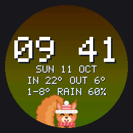
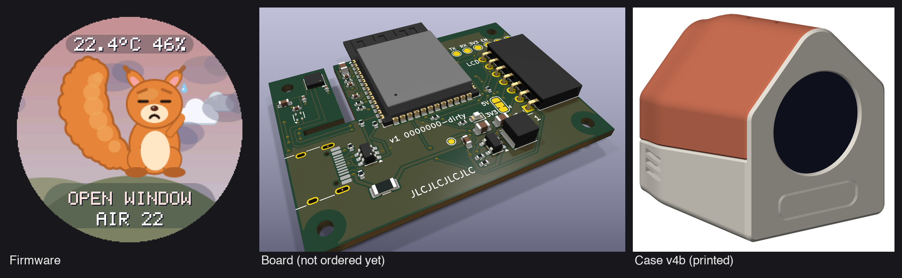

# Desk notifier


A desk display where a mascot shows how good the air is. ESP32-S3, round 240x240 screen, BME688 air sensor.





- **Clock page**: time, date, in/out temperature, today's forecast.
- **Air page**: the mascot's mood follows the indoor air level. Bad air keeps the alert on screen. Press the button (or call the API) to snooze it for 15 minutes.
- **Day page**: the mascot's day at home. It follows the clock (coffee, work, lunch, reading, sleep).
- Everything is in one repo: firmware, custom PCB, 3D-printed case.

It started as the esp_eyes project (animated eyes on two displays). The git history keeps the old work.

## What is in this repo
| Part | Where | State |
|---|---|---|
| Firmware (ESP-IDF v6.1, C++23, host-tested core) | [`firmware/`](firmware/), [`docs/`](docs/) | Runs on a standard ESP32-S3 dev kit with a GC9A01, a BME688 and an SHT40 (sensors, display, Bluetooth setup checked). |
| Board `notifier-v1` (KiCad 10, 4 layers, 50 x 36 mm, JLCPCB assembly) | [`hardware/`](hardware/README.md) | Generated, routed and gate-checked, fab package builds. **Ordered and works**: human review in KiCad, JLC placement preview and the display pinout check are still open ([`ORDER.md`](hardware/notifier-v1/ORDER.md)). |
| Case: A-frame "house" (3 printed parts, no screws) | [`hardware/mechanics/v4_house/`](hardware/mechanics/v4_house/README.md) | v4b and v4c printed. v4d (screen fit, board stilts) modelled, **not yet printed**. Older shells in [`hardware/mechanics/`](hardware/mechanics/README.md) were never printed. |
| Helper tools (page previews, clip preparation) | [`tools/`](tools/), [`clipprep/`](clipprep/) | Used by the checks. |

## Built with AI, reviewed by a human
Most of this repo was written with an AI coding assistant (Claude Code): firmware, KiCad generators, case scripts. The rules for the AI are in [`CLAUDE.md`](CLAUDE.md). A human made the design decisions. The final human review of the board in KiCad is still open (see table).

### What the AI did well
- Display, sensor and Wi-Fi glue code.
- Host tests for the pure logic.
- Page animations and the preview tools.
- Generated schematic and layout scripts.

### What went wrong, and who found it
| Problem | Found by | Fix |
|---|---|---|
| First power design used a linear regulator (about 0.6 W) next to the air sensor. It would warm the sensor. | Fresh-context AI review | Buck converter |
| An LED came out reversed, ERC was clean. A library symbol had its pins rotated. | ERC missed it; the net-intent check now catches it | Net-intent check against the netlist |
| The autorouter put vias into pads and changed the fab rules. | Custom DRC rule | Router flags pinned, DRC rule kept |

### Known gaps
- Generators overwrite edits made in KiCad (see Limitations).
- API and OTA are open until you set a token (see Limitations).

### Rules
- Pure logic lives in `core/` folders with no ESP-IDF includes. It is tested on the PC (ASan, UBSan, `-Werror`).
- Hardware goes through a script gate (`scripts/hw-check.sh`): ERC, DRC, net intent, pin map vs. Kconfig.
- Numbers come from scripts in `hardware/calc/`, not from the AI's memory.
- A fresh-context review for each design step.

Design notes and lessons: [`hardware/PLAN.md`](hardware/PLAN.md).

## Limitations
Please read these before building one.
- **ESP32-S3 only.** The board uses an ESP32-S3-WROOM-1-N8R2.
- **The case is not final.** v4b and v4c are printed ([`v4_house/README.md`](hardware/mechanics/v4_house/README.md)).
  - v4b: the front fell out, the USB-C hole missed the connector, the board was too tight. v4c fixed these: board and front fit.
  - v4c: the screen was tight in its pocket, sat about 6 mm behind the front and leaned back. The display model missed the 2.54 mm header spacer and had the pin row 2.5 mm too high.

  v4d fixes this and is not printed yet: the display now comes from the seller's dimension drawing, the board is placed from the display's header (2.5 mm higher, 3.2 mm further forward, case 3.2 mm shorter), the pocket is 0.5 mm wider and two stilts support the board. There is still no 3D model of the display. A caliper check of the bare board is open. Older shells in `hardware/mechanics/` were never printed.
- **Display orientation is unconfirmed.** The image is mirrored on X by default (`DESK_LCD_MIRROR_X`); flip it in menuconfig if your panel shows it backwards. The pin order of the display module on the board's socket is also still to be checked against a real module.
- **The air score is not BSEC.** It is a simple estimate from humidity and gas resistance and needs a few minutes of warm-up. The sensor reads a little warm next to the board, so indoor temperature is slightly high.
- **No firmware security by default.** The HTTP API, the pet page and OTA are open unless you set a token (`auth token`), the connection is plain HTTP, and the device is meant for a trusted home network. Do not expose it to the internet.
- **Weather and time need the internet** (Open-Meteo, SNTP). Without it the clock stays unset and the weather items disappear. The place defaults to Munich (change it with `POST /api/weather` or `weather at <lat> <lon>`), holidays are Bavarian, and the texts are English.
- **Pictures are stored but not shown** yet, there is one display, and the project is tuned to a single 240x240 round panel at 10 frames per second on a chip without an FPU.
- **The hardware generators overwrite KiCad edits.** Change `hardware/gen/*.py`, not the KiCad files, then re-run the pipeline. The router needs tools that `hardware/tools/setup_tools.sh` downloads, and its result differs between runs.
- **Development on macOS.** The scripts and notes assume macOS and a local ESP-IDF install in `~/esp/esp-idf`.

## What works today
- Rotating pages with fades, 10 frames per second. See [docs/pages.md](docs/pages.md).
- Five mascots, one per board (`idf.py menuconfig` → Desk notifier → Mascot): the squirrel, or a bunny, a stag, a lucky cat with her dog, or a penguin. The new ones have a home page (clock and air level) and a day page that follows their owner's week, and dress for the weather. The squirrel's extras (pet page, hearts, shop, visitors, plant) are add-ons with their own switches. See [docs/mascots.md](docs/mascots.md).
  - Clock: time (set over the internet), date, indoor and outdoor temperature, today's low, high and chance of rain.
  - Air: a squirrel mascot whose mood shows the air level (very good, good, okay, bad), with temperature, humidity and score.
  - Day: the squirrel at its desk at home, doing what fits the time and weekday. The room's climate changes it (stuffy air: it yawns or opens the window; too warm, too cold, too dry, too humid; a sudden smell), so does the weather (umbrella, cocoa, thunder), and special days decorate the room (birthday, anniversary, Christmas, Advent, Halloween, Oktoberfest, ...). The real weather shows in the window, the real time on the wall clock. The scene is never random, but little things are: blinks, glances, a wave, a bird on the windowsill, a ladybug on the desk, a shooting star, a paper plane, a rare golden acorn. The moon shows its real phase, rainbows follow rain, a window-sill plant grows with good air day after day, and a wall calendar counts down to birthdays.
  - Pet page at `http://<device>.local/pet`: feed it, have a coffee break or a party together, pet it, play, water the plant, say good night, give it gifts. Daily visits grow a friendship (five heart levels, never lost) with more reactions and visitors, and squirrel coins for the shop (six things a day: hats, places, things for the room, friends, seasonal specials); the squirrel picks its own outfit.
- Bad-air alert: the air page stays on, snoozed for 15 minutes by the button or by `POST /api/ack`. Without an alert the button shows the next page.
- Web page at `http://<device>.local/` and a small HTTP API.
- Wi-Fi, over-the-air updates, and a serial console.
- Picture upload (the clip format from esp_eyes) is stored but not shown yet.

Planned: pictures that stay on screen until acknowledged, Bosch BSEC2 for a proper IAQ value.

## What you need
Dev setup (works today), or the custom board in `hardware/` once it is built:
- ESP32-S3 board with 8 MB flash and PSRAM (the notifier-v1 board, or an S3 dev board with the same pins)
- GC9A01 round display, 240x240, SPI
- BME688 breakout (I2C)
- A push button (optional)
- USB cable

## The squirrel
The squirrel's mood follows the indoor air quality. What it wears follows the weather outside (Open-Meteo, Munich by default):

| Outside | Squirrel |
|---|---|
| below 8 °C | knitted hat and scarf |
| 25 °C or more | ice cream |
| sunny, daytime | sunglasses |
| drizzle, rain, thunder | umbrella |
| wind of 30 km/h or more | glides under the umbrella, tail streaming |

Items stack (cold, rainy and windy gives hat, umbrella and gliding). Preview every look on your computer with `uv run python tools/preview_pages.py out/` after `scripts/check.sh --quick`.

## Wiring
| Signal | GPIO | Note |
|---|---|---|
| Display SCL / SDA | 6 / 5 | |
| Display DC / RST / CS | 3 / 2 / 4 | |
| Display VCC / GND | 5V / GND | |
| BME688 SDA / SCL | 22 / 23 | 3V3, not 5V. Address 0x77 or 0x76, both are tried |
| Button | 24 | other leg to GND |

Details: [docs/wiring.md](docs/wiring.md). Pins can be changed in `idf.py menuconfig` under "Desk notifier".
If the picture is mirrored, flip `DESK_LCD_MIRROR_X` / `DESK_LCD_MIRROR_Y` there.

## Build and flash
You need ESP-IDF v6.1 and [uv](https://docs.astral.sh/uv/).

```sh
source scripts/idf-env.sh
cd firmware
idf.py -p /dev/cu.usbserial-XXXX flash monitor
```

## Connect to Wi-Fi
Open the serial console and run `wifi "<name>" <password>`. The device reboots and joins your network. It is then reachable as `desk-<last 6 MAC digits>.local`. The timezone is set in menuconfig (`DESK_TZ`, default Central Europe).

## API
By default the API needs no password (change with the console command `auth token`).

```sh
curl http://desk-xxxxxx.local/api/sensor     # temperature, humidity, pressure, gas, score
curl http://desk-xxxxxx.local/api/status     # uptime, memory, Wi-Fi, sensor state
curl -X POST http://desk-xxxxxx.local/api/ack   # snooze the alert
curl http://desk-xxxxxx.local/api/weather    # the last forecast
curl -X POST http://desk-xxxxxx.local/api/page -d '{"page":"day"}'   # clock, air, day or next ("weather" still works)
curl -X POST http://desk-xxxxxx.local/api/weather -d '{"lat":48.137,"lon":11.575,"place":"Munich"}'   # change the place
curl -X POST --data-binary @firmware.bin http://desk-xxxxxx.local/api/ota
```

## Console commands
`wifi`, `status`, `sensor`, `ack`, `page clock|air|day|next`, `weather [refresh | at <lat> <lon> [name]]`, `lcd pins`, `lcd init [hz]`, `hostname`, `auth open|token`, `token`, `reboot`, `factory-reset`.

## About the air-quality score
It is a simple estimate, not Bosch BSEC. 25 points come from humidity (best at 40 %) and 75 from the gas resistance compared with the highest value seen recently. It needs about 3 minutes to warm up and a stretch of clean air to be meaningful. The sensor also reads a little warm because it sits next to the board.

## For developers
`scripts/check.sh` runs the host tests (C++23, sanitizers), the Python tests and the firmware build. `--quick` skips the build. `uv run python tools/preview_pages.py` draws all pages as GIFs on your computer (after a host build). Pure logic lives in `firmware/components/*/core` and is tested on the PC. See [CLAUDE.md](CLAUDE.md) for the layout.

## Hardware and case
- Board: open `hardware/notifier-v1/notifier-v1.kicad_pro` with `hardware/open.sh`. Regenerate with `hardware/tools/pipeline_v1.sh`, check with `scripts/hw-check.sh`, order steps in [`hardware/notifier-v1/ORDER.md`](hardware/notifier-v1/ORDER.md), design notes in [`hardware/PLAN.md`](hardware/PLAN.md). Needs KiCad 10 (`source scripts/kicad-env.sh`).
- Case: print files and notes in [`hardware/mechanics/v4_house/`](hardware/mechanics/v4_house/README.md) (PLA, Bambu Lab plate in `print/`). Older designs: [`hardware/mechanics/`](hardware/mechanics/README.md).
- Firmware: `idf.py build` in `firmware/` (target ESP32-S3). Wi-Fi, time zone and name can be set from a phone over Bluetooth: [`setup/`](setup/README.md).

## License
MIT. The BME68x driver in `firmware/components/sensor/third_party` is from Bosch Sensortec (BSD-3-Clause).
