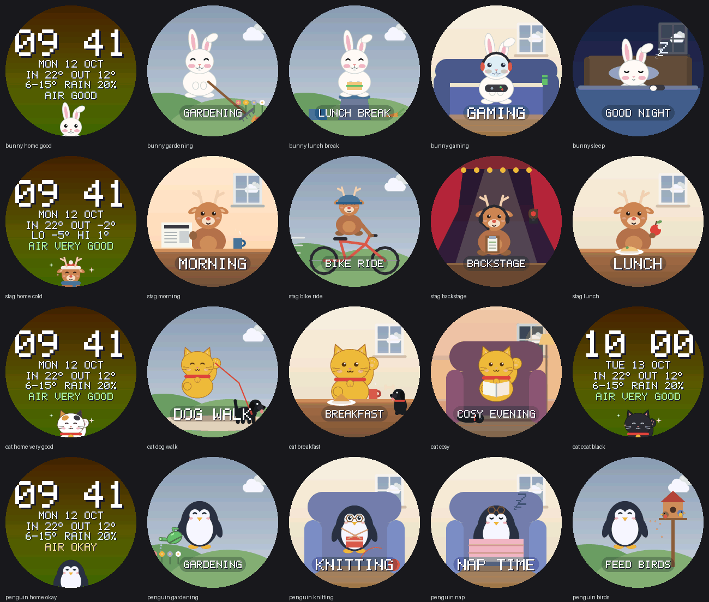

# Mascots



Each board has one mascot, set once in `idf.py menuconfig` → Desk notifier → Mascot. The squirrel keeps its three pages ([pages.md](pages.md)). The four new mascots are made for one person each and have two pages:

| Page | Shows | Time on screen |
|---|---|---|
| Home (clock + air) | Time, date, indoor and outdoor temperature, today's low/high and rain chance, the air level in words, and the mascot peeking in with a face for the air level | `DESK_PAGE_CLOCK_S` |
| Day | The mascot at home or out, doing what fits the time and the weekday. The real weather in the window, or all around it outdoors | `DESK_PAGE_DAY_S` |

When the air is BAD the home page stays on screen, its background pulses red and the text switches between AIR BAD and OPEN WINDOW, until the button or `POST /api/ack` snoozes it for 15 minutes. `POST /api/page` with `air` shows the home page.

## The mascots

| Mascot | Look | Prop | Summer (25 °C and more outside) |
|---|---|---|---|
| Bunny | Plain white, pink inner ears, the right ear tip folded, a smile with two front teeth | Carrot, game controller | Straw hat |
| Stag | Warm brown, cream muzzle, antlers | Apple | Sunglasses |
| Lucky cat | Sitting, one paw raised (it beckons when the air is good), red collar with a bell. Calico on most days, gold or black on about two days in seven, picked from the date | Her small black dog | Paper fan |
| Penguin | Dark blue back, white front, orange beak and feet; reading glasses for knitting and the newspaper | Watering can | Ice lolly |

Below 8 °C outside every mascot wears a knitted hat and a scarf. Clothes are worn on the home page and outdoors on the day page.

| Air level | Face |
|---|---|
| VERY GOOD (70+) | Happy closed eyes, a little hop, sparkles |
| GOOD (50–69) | Open eyes that blink, smile |
| OKAY (35–49) | Half-closed eyes, flat mouth |
| BAD (below 35) | Worried brows, sweat drop |
| Sensor warming up | Asleep, Zzz |

## Their days

The clock decides, never chance: the same time and weekday always give the same scene (`routine_for()` in `screen/core/routine.cpp`). Saturday, Sunday and Bavarian public holidays start later (`DESK_MASCOT_WEEKEND_LATE_MIN`).

**Bunny** (apprentice gardener and gamer). Mon–Fri: alarm and snooze at 05:45, lunchbox and boots, gardening 07:00–16:00 (raking leaves September to February, planting March to August; rain jacket in rain, WINTER DUTY with a snow shovel on snowy days), lunch break on an upturned bucket at 12:00, home with muddy boots at 16:00, gaming with headset and controller, dinner at 19:00, asleep with the controller in the paw from 23:00. Weekend: asleep until 10:30, breakfast, gaming. Friday and Saturday 21:00–01:00: OUT TONIGHT, the burrow is empty.

**Stag** (retired and active, leads the backstage crew at the theatre). Coffee and newspaper at 07:00, bike ride until lunch (the workshop when it rains), lunch with an apple, garden or workshop in the afternoon, dinner at 18:00, TV, bed at 22:30. Show nights (`DESK_STAG_SHOW_DAYS`, Thursday to Saturday by default, 17:30–23:00): an early dinner, then BACKSTAGE with headset, cue list and cue light. A free weekend day: a longer ride, lunch at 13:00, coffee and cake at 15:00.

**Lucky cat** (retired, with her small black dog). Wakes at 06:30 (the dog jumps on the bed), dog walk at 07:00 (two hours on Sunday, umbrella in rain), breakfast with a treat for the dog, errands, lunch, a rest in the armchair with the dog beside her, coffee and cake at 15:00, a short evening walk at 17:00 (`DESK_CAT_EVENING_WALK`), supper at 18:00, a cosy evening with a book and the dog asleep on her feet, bed at 22:00.

**Penguin** (retired, loves her garden). Coffee and newspaper at 06:30, gardening 08:00–11:00, knitting, lunch, a nap with the glasses pushed up at 13:00, knitting, coffee and cake at 15:00, feeding the birds at 16:00, supper at 18:00, TV, bed at 21:30. Sunday: church at 10:00 and a Sunday roast at 12:00.

At home (not while out, at work, at the theatre or asleep) the room's climate and the weather add to the scene, first match wins: New Year's Eve from 22:00 (party hat, fireworks in the window), thunder in the evening (THUNDER!, also in bed), stale air on a mild dry day (the window opens: AIR OUT), 26 °C or more inside (a glass of water: DRINK WATER), below 18 °C (tea: CHILLY), rain or snow in the evening (cocoa: COSY EVENING). Christmas, Easter and the owner's birthday (`DESK_DAY_BIRTHDAY`, `DESK_DAY_BIRTHDAY_NAME`) put a tree, an egg basket or a cake in the corner and add a line to the caption.

## Settings

`idf.py menuconfig` → Desk notifier:

| Option | Default | |
|---|---|---|
| Mascot (`DESK_MASCOT_*`) | Squirrel | Bunny, Stag, Lucky cat, Penguin |
| `DESK_MASCOT_WAKE` / `DESK_MASCOT_BED` | bunny 545 / 2300, stag 700 / 2230, cat 630 / 2200, penguin 630 / 2130 | HHMM |
| `DESK_MASCOT_WEEKEND_LATE_MIN` | bunny 285 (until 10:30), others 30 | |
| `DESK_BUNNY_WORK_START` / `_END` | 700 / 1600 | |
| `DESK_STAG_SHOW_DAYS` | 0x70 (Thu, Fri, Sat) | bit 0 = Sunday .. bit 6 = Saturday |
| `DESK_STAG_SHOW_START` / `_END` | 1730 / 2300 | |
| `DESK_CAT_EVENING_WALK` | on | |

Birthdays stay in the local, ignored `sdkconfig`, never in the repo.

### Add-ons

The squirrel's extras each have a switch under Add-ons. They are on for the squirrel and off for the new mascots unless switched on.

| Option | What it adds | Needs |
|---|---|---|
| `DESK_ADDON_PET_PAGE` | `/pet`, `/api/pet` and the reactions on screen | |
| `DESK_ADDON_BOND` | Hearts and coins | Pet page |
| `DESK_ADDON_SHOP` | `/api/shop`: hats, places, decoration, friends | Hearts |
| `DESK_ADDON_VISITORS` | Birds, butterflies, hedgehogs and the others dropping by | |
| `DESK_ADDON_PLANT` | The window-sill plant | |

In this first version the add-ons only show on the squirrel's pages. The new mascots' reactions, shop things and visitors come in a later change; their switches already exist so a board can be set up once.

## Preview

```sh
scripts/check.sh --quick
uv run python tools/preview_pages.py build/preview mascots   # each mascot's home page per air level and coat, and every scene of its week
```
