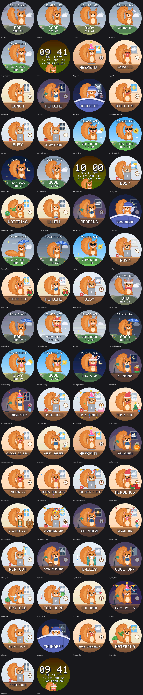
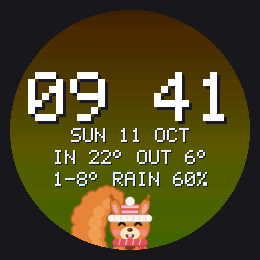

# Screen pages



The display turns through three pages and fades between them. It draws 10 frames per second, so the pictures move.

| Page | Shows | Time on screen |
|---|---|---|
| Clock | Time, date, indoor and outdoor temperature, today's low and high (with the chance of rain from 20 %), a small squirrel peeking in | 12 s |
| Air | The squirrel mascot in front of the outdoor weather, indoor temperature and humidity, the air level and score | 15 s |
| Day | The squirrel at its desk at home, doing what fits the time of day. The real weather in the window, the real time on the wall clock | 12 s |



## The squirrel

The squirrel shows the indoor air from the BME688:

| Air level | Squirrel |
|---|---|
| VERY GOOD (score 70+) | Hops, holds its acorn, happy closed eyes, sparkles, flowers |
| GOOD (50–69) | Smiles, holds its acorn, blinks, wags its tail |
| OKAY (35–49) | Half-closed eyes, flat mouth, acorn put down, tail droops a bit |
| BAD (below 35) | Worried face, sweat drop, fans the air with its paw, grey haze. The text switches between BAD and OPEN WINDOW |
| Sensor warming up | Sleeps under the stars, Zzz |

Behind the squirrel the sky shows the weather outside: sun, moon and stars at night, clouds, rain, snow (the hill turns white), fog, thunderstorms with lightning. Under rain and storms the hill gets darker.

The squirrel dresses for the outdoor temperature:

| Outside | Squirrel |
|---|---|
| below 8 °C | Knitted hat with a pom-pom and a scarf |
| 25 °C and more | Strawberry ice cream with a cherry, slowly melting. It holds it in both paws (very good, good, okay), in the free paw while it fans the air (bad), or puts it down next to it (sleeping) |

Before the first forecast arrives the air page uses its own colours for each air level and no outfit.

When the air is BAD the air page stays on screen and its sky pulses red until you press the button or call `POST /api/ack` (15 minutes snooze).

## The squirrel's day

The day page shows what the squirrel is doing at home. It follows the clock, never chance: the same time on the same weekday always gives the same scene, and only the small animation inside a scene moves.

| Weekdays | Squirrel | Text |
|---|---|---|
| 06:30–08:59 | Holds a steaming mug, takes a sip every few seconds | COFFEE TIME |
| 09:00–11:59, 13:00–17:59 | Laptop open, screen light on its face, cold coffee on the desk | BUSY |
| 12:00–12:59 | Pumpkin soup, spoon to mouth, cheeks full while chewing | LUNCH |
| 18:00–18:29 | Closes the laptop, then a big happy stretch | WORK DONE |
| 18:30–22:59 | Reads a book under the desk lamp, a page turns now and then | READING |
| 23:00–06:29 | In bed with a nightcap, the blanket rises and falls, Zzz | GOOD NIGHT |

On Saturday, Sunday and Bavarian public holidays it sleeps 90 minutes longer, has coffee for two hours, lunch as usual, and reads the rest of the day.

### The room's climate and the weather

The measured air and the forecast change what the squirrel does. The first match wins:

| When | Squirrel | Text |
|---|---|---|
| 31 Dec from 22:00 until 00:30 | Party hat, sparkler, fireworks in the window | COUNTDOWN, HAPPY NEW YEAR |
| The air score dropped 15 points within half an hour | Holds its nose, green stink lines | STINKY AIR! |
| Thunder in the evening or at night | Blanket pulled up to the nose, flinches at each flash | THUNDER! |
| Air OKAY or BAD, outside 10–24 °C, dry, calm | Opens the window, the curtain blows in | AIR OUT |
| Room 26 °C or more, outside 3° cooler, evening | Opens the window | COOL OFF |
| Air OKAY or BAD during work (and too wet to air out) | Yawns over the laptop | STUFFY AIR |
| Room 26 °C or more | Fans itself with a leaf, red thermometer | TOO WARM |
| Room below 18 °C | Knitted shawl, a cup of tea, blue thermometer | CHILLY |
| Humidity over 65 % | Steamed-up window, a mushroom on the sill | TOO HUMID |
| Humidity under 35 % | Sips water, mists the plant | DRY AIR |
| Rain likely (60 %+) on a work morning | An umbrella leans against the desk | TAKE UMBRELLA |
| Rain or snow in the evening | Cocoa next to the book | COSY EVENING |
| Sunny, 15 °C or more, on a day off | Waters the plant | WATERING |

The window shows the weather on the glass too: raindrops, frost in the corners on freezing mornings, a fogged pane with a wiped peephole, leaves blowing past at 30 km/h or more, a snowman on snowy days.

### Special days

| Day | Decoration | Text |
|---|---|---|
| Birthday (menuconfig, default 2 Feb) | Cake with a candle, party hat, garland, confetti | HAPPY BIRTHDAY, then the name |
| Wedding anniversary (menuconfig, default 23 Oct) | A rose, hearts, heart garland | ANNIVERSARY, LOVE YOU! |
| 24–26 Dec | Christmas tree, Santa hat | MERRY XMAS |
| 31 Dec | Garland | NEW YEAR'S EVE |
| 1 Jan | Confetti, sleeps in even longer | HAPPY NEW YEAR |
| Easter Sunday and Monday | Basket of eggs | HAPPY EASTER |
| Advent | A wreath with one to four candles; on Sundays the text says which Advent | 2. ADVENT |
| 6 Dec | Boot with an orange and nuts, Santa hat | NIKOLAUS |
| 11 Nov, evening | A paper lantern in the window | ST. MARTIN |
| 31 Oct | Carved pumpkin, lit in the evening | HALLOWEEN |
| Last Sunday of March and October | The wall clock spins forward or back | CLOCKS FORWARD, CLOCKS GO BACK |
| Oktoberfest (from the Saturday 15 days before the first Sunday of October) | Pretzel, Lederhosen braces | O'ZAPFT IS! |
| 21 Jan, Squirrel Appreciation Day | Crown, acorn cake, garland | SQUIRREL DAY |
| 14 Feb | Pink mug, a rose, hearts | VALENTINE |
| 1 Apr | The wall clock runs backwards | APRIL FOOL! |
| Friday after work | Party hat | WEEKEND! |
| Monday morning | The big mug | MONDAY... |

When there is more than one text, they take turns every 4 seconds.

The window shows the weather outside (sun, moon, clouds, rain, snow, fog, thunder), the wall clock the real time, and the room gets darker in the evening. The face still follows the indoor air. The page is left out until the time is known.

Change the times, the birthday (with the name) and the anniversary in `idf.py menuconfig` → Desk notifier → Squirrel's day (times as HHMM, so 630 is 06:30; dates as MMDD, so 202 is 2 February, 0 turns it off). Bedtime may be after midnight (e.g. 30).

## Little surprises

Which scene shows never changes by chance. Inside a scene, small things happen at random moments, different after every boot (the seed comes from the hardware random number generator):

- The squirrel blinks (sometimes twice), glances to the side, twitches an ear, flicks its tail and does a little hop.
- On the air page it now and then waves hello, and with very good air it throws its acorn up and catches it.
- On the full hour the clock-page squirrel pops up a little and waves for ten seconds.
- Roughly every other minute a visitor may come by for about twelve seconds:

| Visitor | Where | When |
|---|---|---|
| Blue tit | Lands on the squirrel's head and sings (air page), hops along the window sill and pecks (day page) | Daylight, dry, not windy |
| Butterfly | Flutters past | Daylight, dry, 12 °C or more outside (15 °C on the day page) |
| Ladybug | Walks along the desk | The squirrel is awake |
| Moth | Circles the reading lamp | Reading in the evening |
| Shooting star | Streaks across the sky or the window | Clear night |

Preview them with `uv run python tools/preview_pages.py build/preview fun_air_bird fun_day_bird fun_clock_hour` (all scenes starting with `fun_`); each clip starts at a moment where its surprise happens.

## Weather

The board asks [Open-Meteo](https://open-meteo.com/) every 20 minutes. No account or key is needed. The air page shows it as the sky behind the squirrel and as the squirrel's outfit, the day page in the window, the clock page as numbers. There used to be a separate weather page; it showed the same sky and temperature again and was replaced by the day page. If the last good forecast is older than 3 hours, the pages fall back to their own colours.

Change the place over the API:

```sh
curl -X POST http://desk-xxxxxx.local/api/weather -d '{"lat":52.52,"lon":13.405,"place":"Berlin"}'
```

or with the console command `weather at 52.52 13.405 Berlin`, or in `idf.py menuconfig` → Desk notifier → Weather.

## Controls

| How | What |
|---|---|
| Button | During a BAD-air alert: snooze it. Otherwise: next page |
| `POST /api/page` `{"page":"day"}` | Fade to a page (`clock`, `air`, `day`, or `next`; `weather` still works and means `day`) |
| `POST /api/page` `{"refresh_weather":true}` | Fetch the forecast now |
| `POST /api/weather` `{"lat":..,"lon":..,"place":".."}` | Change the forecast location |
| `GET /api/weather` | The last forecast as JSON |
| Console `page day`, `page next` | Same as the API |
| Console `weather`, `weather refresh` | Show or fetch the forecast |

Page times and the frame rate are in `idf.py menuconfig` → Desk notifier → Pages. Set a page time to 0 to skip that page.

## Preview on your computer

```sh
scripts/check.sh --quick                 # builds build/host/page_preview
uv run python tools/preview_pages.py     # GIFs and sheet.png in build/preview
```

The preview uses the same drawing code as the board.

The props of the day page (pumpkin, wreath, leaf fan, rain on the glass, ...) have their own sheet, one row per prop at scene size and enlarged:

```sh
cmake --build build/host --target prop_sheet && uv run python tools/prop_sheet.py   # build/props/sheet.png
```

To check every combination, add `matrix`: one sheet per weather (`build/preview/matrix_*.png`), rows are the air levels, columns are day and night at -2, 15 and 29 °C:

```sh
uv run python tools/preview_pages.py build/preview matrix
```
